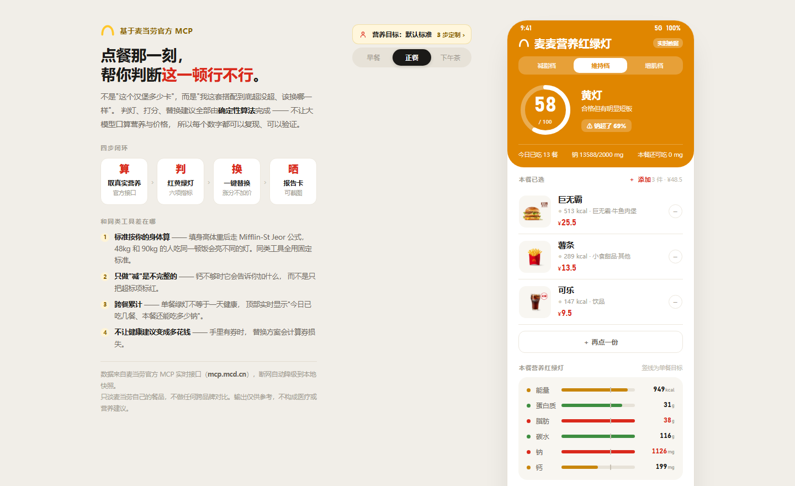
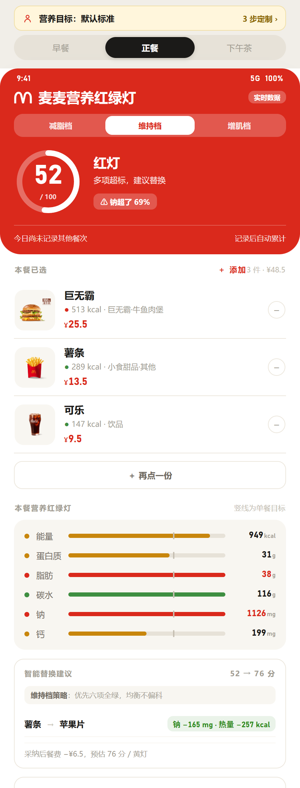
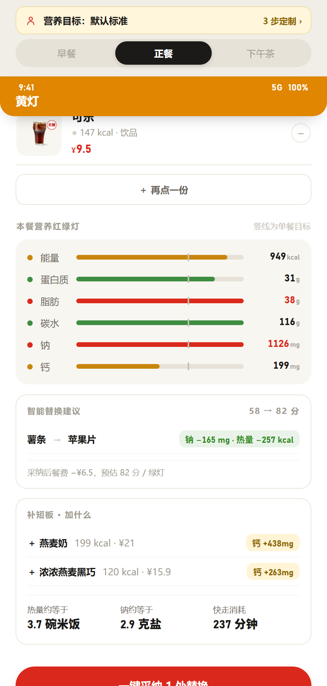

<p align="center">
  
</p>
<p align="center">
  
  
</p>

<h1 align="center">麦麦营养红绿灯</h1>
<p align="center">点餐时实时判读这一顿的营养，用红黄绿灯告诉你哪项超标、哪项不够，并给出一键替换与补短板建议。</p>

> **一句话**：取数交给 MCP，算术交给代码，表达交给 Agent。
> 所有热量、钠、钙的计算都是**确定性算法**，不让大模型口算——所以数字可以复现、可以验证。

---

## 为什么要做这个

麦当劳官方 App 已经能查到餐品营养，但用户在点餐那一刻要回答的其实是三个问题：

1. **这一顿，行不行？** —— 不是"这个汉堡多少卡"，而是"我这套搭配到底超没超"
2. **不行的话，换什么？** —— 而不是看完数字自己琢磨
3. **我这个人，标准是什么？** —— 45kg 女生和 90kg 健身教练不该用同一把尺子

现有的同类工具几乎都停在第一步（把营养值列出来就结束了）。
本项目把四步做完：**算 → 判 → 换 → 晒**，并且把"标准"变成**按你身体数据算出来的**。

---

## 有什么不一样

| 能力 | 说明 |
|---|---|
| **红绿灯判读** | 能量 / 蛋白质 / 脂肪 / 碳水 / 钠 / 钙 六项，各给红黄绿，附「钠超了 69%」这样的最严重超标提示 |
| **个性化目标** | 填性别 / 年龄 / 身高 / 体重 / 活动量，按 **Mifflin-St Jeor** 公式算 BMR→TDEE，再按档位调整。48kg 与 90kg 的人，同一顿饭会亮不同的灯 |
| **三档切换** | 减脂（TDEE−400）/ 维持 / 增肌（TDEE+300），蛋白质按体重 g/kg 调整 |
| **智能替换** | 在**实时菜单**里穷举同类餐品，挑出"涨分且不显著加价"的方案，并标出每项收益（钠 −165mg / 热量 −257kcal） |
| **补短板** | 只做"减"是不完整的：钙不够时它会告诉你**加什么**（燕麦奶 → 钙 +438mg 达标） |
| **跨餐累计** | 单餐绿灯 ≠ 一天健康。英雄卡下方实时显示「今日已吃 2 餐 · 钠 1548/2000mg · 本餐还可吃 452mg」 |
| **券不浪费** | 手里有薯条券时，替换方案会计算"券损失"，不让健康建议变成让你多花钱 |
| **具象换算** | 949 kcal ≈ 3.7 碗米饭；1126mg 钠 ≈ 2.9 克盐；快走 237 分钟才能消耗掉 |

---

## 30 秒上手

```bash
# 1. 准备 Token（免费申请，两步）
#    打开 https://open.mcd.cn/mcp → 手机号登录 → 控制台 → 激活 → 复制 Token

# 2. 配置环境变量（Windows PowerShell）
setx MCD_MCP_TOKEN "你的_token"
#    macOS / Linux: export MCD_MCP_TOKEN="你的_token"

# 3. 启动（零依赖，只用 Python 3.10+ 标准库）
python src/server.py
#    浏览器打开 http://127.0.0.1:8000
```

没有 Token 也能跑：会自动降级到 `data/` 离线快照，界面右上角显示「离线数据」。

### 自检

```bash
python tests/selftest.py           # 离线验收（32 项断言）
python tests/selftest.py --live    # 附真实 MCP 取数校验
```

---

## 判灯标准（可复现）

以《中国居民膳食指南(2022)》成人每日推荐量 ÷ 3 作为**默认**单餐目标：

| 指标 | 单餐目标 | 类型 | 红灯 | 黄灯 |
|---|---|---|---|---|
| 能量 | 700 kcal | 限制 | > 目标的 1.5 倍 | > 目标 |
| 蛋白质 | 25 g | 达标 | < 70% | 70%–100% |
| 脂肪 | 23 g | 限制 | > 1.5 倍 | > 目标 |
| 碳水 | 50 g | 达标 | < 70% | 70%–100% |
| 钠 | 667 mg | 限制 | > 1.5 倍 | > 目标 |
| 钙 | 267 mg | 达标 | < 70% | 70%–100% |

得分 = 100 − 15×红灯数 − 6×黄灯数；**≥80 绿灯、55–79 黄灯、<55 红灯**。

个性化时（`src/nutrition.py: compute_modes`）：

```
BMR  = 10×体重 + 6.25×身高 − 5×年龄 + 5（男） / −161（女）      # Mifflin-St Jeor
TDEE = BMR × 活动系数（久坐 1.2 / 轻度 1.375 / 中度 1.55）
每日热量：减脂 = max(1200, TDEE−400)｜维持 = TDEE｜增肌 = TDEE+300
蛋白质：体重 × 1.8 / 1.2 / 1.8 g（减脂保肌、维持、增肌）
脂肪：每日热量 × 22% / 27% / 25% ÷ 9
碳水：(每日热量 − 蛋白×4 − 脂肪×9) ÷ 4
钠、钙与体重无关：2000mg / 800mg 每日（WHO / 膳食指南）
```

---

## 架构

```
麦当劳 MCP (mcp.mcd.cn)
   │  query-nearby-stores / query-meals / list-nutrition-foods
   │  query-my-coupons / available-coupons / calculate-price
   ▼
src/mcp_client.py     ← 唯一出口，Token、限流、降级都在这里
   ▼
src/nutrition.py      ← 纯函数引擎：判灯、打分、个性化、替换、补短板
src/daylog.py         ← 跨餐累计（本机 JSON，不上传）
   ▼
src/server.py         ← 零依赖 HTTP 服务（API + 静态页面）
   ▼
web/index.html        ← 界面：沉浸式红绿灯顶栏，颜色即结论
```

### 目录

```
src/mcp_client.py     MCP 客户端（JSON-RPC over Streamable HTTP，零依赖）
src/nutrition.py      营养引擎（无 IO，纯函数，可单测）
src/daylog.py         当日累计
src/server.py         本地服务与 API
web/index.html        前端界面
data/                 离线快照（菜单 101 款 / 营养表 158 款）
tests/selftest.py     验收自检（43 项）
MCP_INTEGRATION.md    用到的 MCP Tool 与调用流程说明
CONTEST_DECLARATION.md 参赛声明（官方原版）
```

---

## 目标用户

- **健身 / 减脂人群**：需要按体重和训练目标定制标准，而不是看通用推荐值
- **经常吃麦当劳的上班族**：想知道"今天还能不能吃"，而不只是"这顿多少卡"
- **给家人点餐的人**：需要直观的红绿灯，而不是一堆数字
- **营养师 / 健身教练**：需要一个能量化、可复现的餐品评估工具

---

## 数据与合规

- 餐品信息、营养值、图片、价格**全部来自麦当劳官方 MCP 实时接口**（`https://mcp.mcd.cn`），
  代码中不含任何手工编造的营养数据；`data/*.json` 是实时结果的离线快照，仅用于断网降级。
- 本项目**只谈麦当劳自己的餐品**，不做与其他品牌的任何对比。
- 项目输出仅供参考，不构成医疗或营养专业建议；实际餐品信息以麦当劳官方渠道为准。
- 仓库内**不含任何真实 Token、密钥或他人个人信息**，配置文件仅使用环境变量占位符（见 `mcp-config.example.json`）。
- 参赛声明见 [CONTEST_DECLARATION.md](CONTEST_DECLARATION.md)；MCP 接入细节见 [MCP_INTEGRATION.md](MCP_INTEGRATION.md)。

## 许可

MIT
